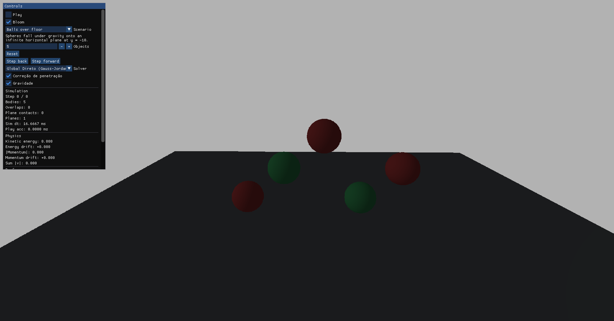
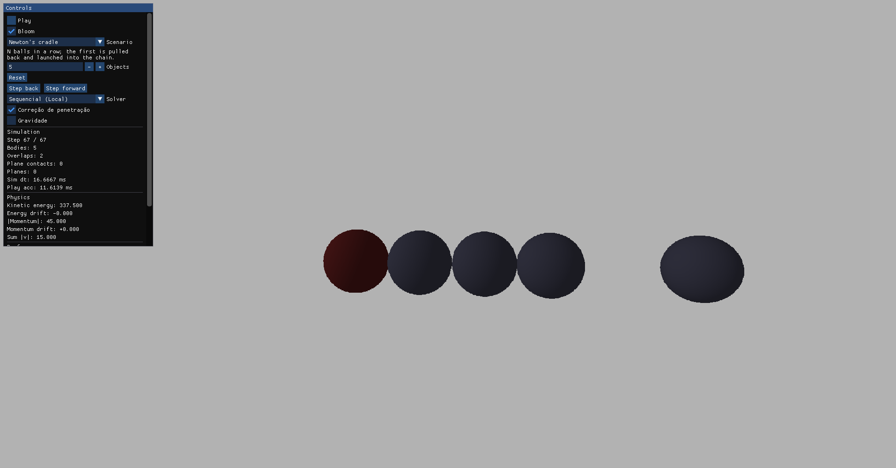

# impulse-dynamics

Simulador experimental em **C++20** para comparar três estratégias de **resolução de colisões por impulso** entre esferas (sequencial, global com matriz de Delassus + Gauss–Jordan, iterativo com Gauss–Seidel). Inclui visualização 3D interativa, linha do tempo passo a passo e *benchmark* *headless* para medir apenas `World::step`.

Repositório relacionado ao TCC *Análise comparativa entre sistemas de resolução de colisão de corpos num modelo baseado em impulsos* (IFC — Ciência da Computação).

## Capturas de tela





## Requisitos

- **Linux** com OpenGL 4.x (Mesa ou drivers proprietários)
- **CMake** ≥ 3.20, compilador **C++20** (GCC ou Clang)
- Dependências típicas (Fedora): `gcc-c++`, `cmake`, `git`, `mesa-libGL-devel`, `glfw-devel`, `glm-devel`
- Submodule de renderização: após clonar, inicialize `external/tmig`

## Compilação

```bash
git clone https://github.com/mickaelrei/impulse-dynamics.git
cd impulse-dynamics
git submodule update --init --recursive

cmake -B build -DCMAKE_BUILD_TYPE=Release
cmake --build build -j
```

Binários principais:

- `build/impulse-dynamics` — aplicação interativa
- `build/physics-scenarios-bench` — *benchmark* sem janela gráfica

## Executando a aplicação interativa

```bash
./build/impulse-dynamics
```

### Cenários (*Scenario*)

Selecione no combo do painel **Controls** (ou reinicie com **Reset** após trocar):

| Cenário | Uso |
|---------|-----|
| Head-on collision | Colisão frontal |
| Unequal mass | Massas diferentes |
| Newtons Cradle | Cadeia estilo pêndulo de Newton (sem gravidade) |
| Simultaneous hit | Dois impactos no corpo central |
| Double-ended hit | Impacto duplo |
| Balls over floor / Vertical stack | Gravidade + plano (ambiente) |

Cenários com contagem variável de corpos permitem ajustar **Objects** antes do **Reset**.

### Resolvedores (*Solver*)

- **Global Direto (Gauss-Jordan)** — sistema acoplado, eliminação densa
- **Global Iterativo (Gauss-Seidel)** — mesma matriz; slider **Iterações GS**
- **Sequencial (Local)** — *one-pass* na ordem da detecção

### Atalhos e controles

| Entrada | Ação |
|---------|------|
| **Play** | Avanço contínuo da simulação |
| **Step forward / back** | Um passo na linha do tempo |
| **J** / **K** | Retroceder / avançar um passo (teclado) |
| **Reset** | Reinicia o cenário atual |
| **Correção de penetração** | Liga/desliga projeção posicional pós-impulso |
| **Gravidade** | Liga/desliga gravidade no `World` |
| **Bloom** | Pós-processamento visual |
| Mouse + WASD | Câmera (*first-person*) |

O título da janela exibe **FPS** aproximado. O painel **Performance** mostra tempo de renderização e tempo do passo físico (`World::step`); para comparação formal entre *solvers*, use o *benchmark* abaixo.

## Benchmark de desempenho (*headless*)

Mede tempo médio de `World::step` por cenário e *solver*, sem OpenGL:

```bash
./scripts/run-physics-benchmark.sh
```

Saída: `benchmark/physics_step_summary.csv`

## Estrutura do código (resumo)

```
include/core/     corpos, colisões, planos, métricas
include/math/     matriz, Delassus, Gauss–Jordan / Seidel
include/solvers/  Sequential, Global, Iterative
include/sim/      World, timeline, cenários
include/render/   SceneRenderer
src/main.cpp      loop principal + ImGui
```

## Licença e créditos

Projeto acadêmico. Renderização via submodule [tmig](https://github.com/mickaelrei/tmig) (OpenGL + GLFW + ImGui).
